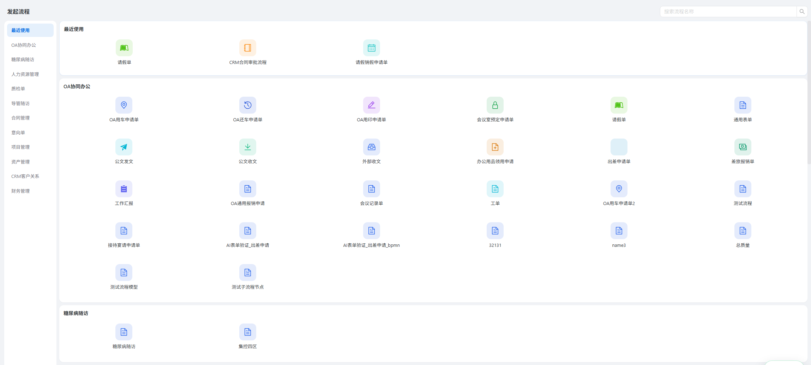
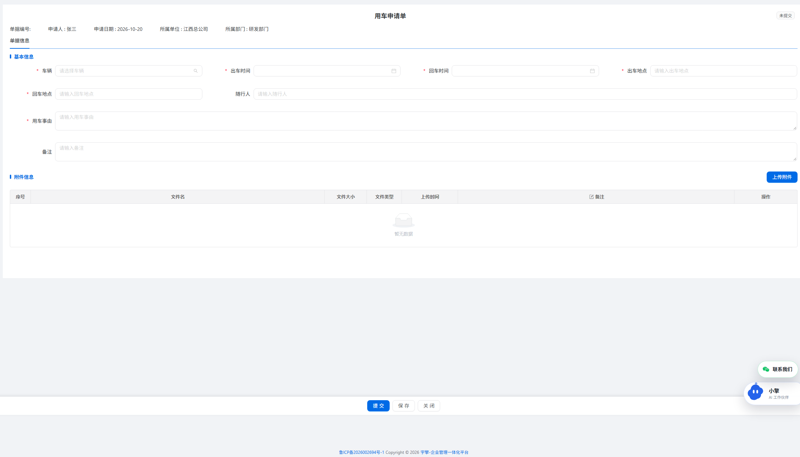

# 任务

- [x] 参照上图对发起流程进行页面重构，左边选项对应流程模板的分类进行展示，在点击左边选项时跳到对应分类的流程区域
- [x] 请你判断发起流程页面的内容是否可组件化，如果可以请进行组件化，那么就保证后续添加了其他分类的流程时，可以不动代码就能展示出来
- [x] 上图的流程图标根据注册的图标让流程设计时进行选择，请你完善流程图标选择的功能，功能放在流程设计页面去

- [x] 上图是用户点击了对应流程后跳转出来的页面，页面直接展示流程对应的表单信息给用户填写
- [x] 其中单据编号由系统生成，申请日期是发起时的日期，下方还有提交和保存、关闭按钮

# 主要事项

1. 用户点击流程出现的页面不添加到菜单中去，页面中左上角设置返回按钮，返回到发起流程页面
2. 保存按钮和提交按钮的功能你自己完善

---

## 执行记录（2026-10-21）

| 要求 | 实现 |
| --- | --- |
| 左侧分类导航 + 点击跳转对应分区 | 分类与流程**全部来自接口**（`category`/`icon`），左栏条数徽标；点击平滑滚动，滚动反向高亮（IntersectionObserver） |
| 可组件化、加分类不改代码 | 拆为 `ApplyCategoryNav.vue` + `ApplyFlowCard.vue`；新增分类的模板上线即自动出现在导航与分区，空分类不渲染 |
| 流程图标在设计页选择 | 「节点基本 → 流程图标」：可搜索下拉（选项取自 `LUCIDE_ICON_NAMES` 注册表，带图标预览）+ 实时预览；新增/编辑回显与保存均贯通 |
| 点流程进入填单页 | 隐藏路由 `/workflow/apply/:flowCode`（不进菜单），直接渲染该模板绑定的表单 |
| 单据编号系统生成、申请日期为发起日 | 编号 `{流程编码大写}-{yyyyMMdd}-{四位序号}`，保存草稿时即生成并全程不变；申请日期取当天 |
| 提交 / 保存 / 关闭 | 提交=直接起流程；保存=存草稿（可反复保存，走更新）；关闭=有改动时二次确认后返回 |
| 左上角返回 | 返回按钮回 `/workflow/apply` |
| 保存与提交的功能自行完善 | 补齐「草稿」全链路：保存 → 更新 → 提交；「我的流程」页草稿行新增「提交」按钮 |

验证：`verify_apply.py` 7/7、`apply_ui.js` 13/13、`mine_draft_ui.js` 6/6、`pages_smoke.js` 11/11；测试数据残留 0（实例回基线 5 条）。
