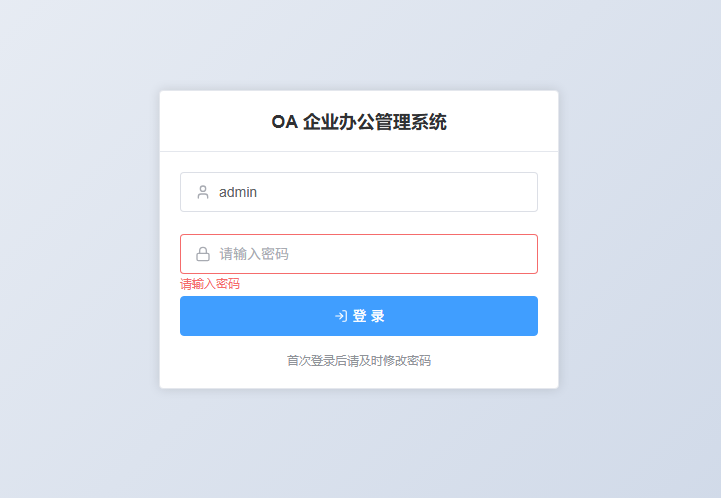

# 任务

- [x] 完善抄送任务子菜单的图标选用（`MailCheck`）

- [x] 取消登录页面的图标文字提示（已移除 el-tooltip；Tab 现在直达密码框）
- [x] 设计、下架、发布、停用、启用、挂起、终止、置顶 图标：`PenTool` / `Archive` / `Rocket` / `Ban` / `Power` / `Pause` / `OctagonX` / `Pin`（全部在 Lucide 中找到；「停用/启用」当前是单选框而非按钮）
- [x] 操作栏只留图标并放大（18px，`icon-only`）：15 个列表页共 47 个按钮；无图标映射时自动回退文字
- [x] 表头与表内容居中（全局 CSS）
- [x] 用户管理：新增员工编号/性别/邮箱；表头改为 职务/角色范围/所属部门/人员状态；删除「状态值」；列超宽自动横向滚动（人员状态与操作固定右侧）

# 注意事项

1.  调整图标大小时，需设计合理
2. 如果图标在两个图标库中都没找到，则保留文字按钮
---

## 执行记录（2026-10-20）

| 项 | 结果 |
| --- | --- |
| 抄送任务图标 | `MailCheck`（库已更新，菜单 226） |
| 登录页提示 | 移除 el-tooltip；Tab 从账号直达密码框（`activeElement.type=password`） |
| 8 个动作图标 | 全部在 Lucide 命中，未动用 Element Plus |
| 操作列图标化 | 15 个列表页 / 47 个按钮；图标 18px，文字保留为 `title` 悬浮提示；无映射时回退文字 |
| 表格居中 | 全局 CSS，表头与单元格均 `text-align:center` |
| 用户管理列 | 新增员工编号/性别/邮箱；改 4 个表头；删「状态值」；列宽合计 1350>1156 触发横向滚动，人员状态与操作固定右侧 |

验证：`vue-tsc -b` exit 0；浏览器 `doc_tasks_ui.js` **11/11**；抽样核对 通知管理/流程模板/实例/角色 的操作按钮均已带图标。
